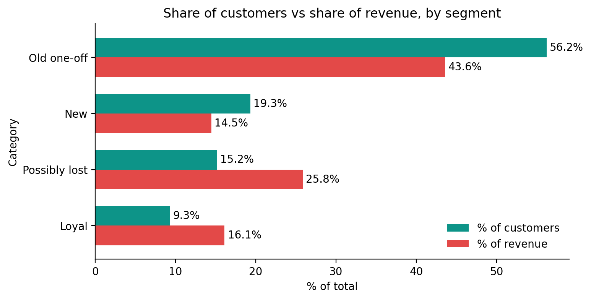

# TheLook E-commerce Customer Share and Retention

Personal project looking at what type of customers there are and how to retain them for business with SQL (BigQuery) and Python (Pandas).

## Project Question

**What type of customers are there in this database, and how can we retain them for maximum profit?**

## Project Materials

- **[SQL queries](sql/)** - numbered SQL queries ran in BigQuery that were used to profile the database and create clean tables for analysis.
- **[Notebook](notebooks/ecommerce_pandas.ipynb)** - notebook that contains the pandas analysis of the created clean tables.
- **[Segment chart](visuals/segment_share.png)** - the type of customer and the contribution they have to revenue.
- **[Cleaning notes](cleaning_notes.md)** - more details on the cleaning process.
- The data is the public BigQuery dataset `bigquery-public-data.thelook_ecommerce`, therefore no data files have been added as it is accessible. Three of seven tables were used (`order_items`, `products`, `users`).
- This database is constantly updated, so everything you see is a snapshot from the 16th of November 2026.

## Cleaning and Analysis

- Tools and ideas used for cleaning include; removing order items dated on or after the aforementioned date using a cutoff (complete days only), leaving out the shipping dates because some orders had a creation date after their shippind date, leaving out personal and unnecessary user fields (only leaving enough to profile the user to their order), and adding a margin column and a `is_revenue` flag (only for Complete and Shipped orders) so that cancelled, returned and processing items are kept for analysis.
- No duplicate ids and no missing or invalid prices or user ids were found.
- Cleaned tables were validated using checks for the predicted amount of data retained.
- In pandas, the cleaned data was filtered to revenue items, then grouped to one row per customer with their recency (days since last purchase), frequency (number of orders) and monetary value (total spend).
- Customers were segmented by whether they are a repeat buyer (2 or more orders) and whether they are recent (last purchase within 180 days). 180 days is an assumption, and testing 90 and 365 days changed the size of the recent group from 18.5% to 44.5%.
- See the [cleaning notes](cleaning_notes.md) for reasoning behind cleaning steps.

| Segment | Definition | Customers | Avg spend | Share of revenue |
|---|---|---|---|---|
| **Old one-off** | 1 order, last purchase over 180 days ago | 29,612 (56.2%) | £87 | 43.6% |
| **New** | 1 order, last purchase under 180 days | 10,174 (19.3%) | £84 | 14.5% |
| **Possibly lost** | 2+ orders, last purchase over 180 days ago | 7,997 (15.2%) | £191 | 25.8% |
| **Loyal** | 2+ orders, last purchase under 180 days | 4,886 (9.3%) | £195 | 16.1% |

## Conclusion

- Using the analysis, it can be seen that 75.5% of customers bought only once, and the 24.5% who are repeat buyers bring in about 42% of revenue.
- The largest group is old one-time buyers (56% of customers, 44% of revenue), but they bought once, long ago.
- The best win-back target is the "Possibly lost" segment, who have already bought more than once and spend about £191 each.
- Conversion of one-time buyers into repeat buyers can be done by following up soon after a first order with a recommendation or second-order offer, personalising win-back offers to "Possibly lost" customers, and emphasising retention messaging to repeat buyers.
- These recommendations are hypotheses, which should be tested on a sample before deciding to integrate.
- Average spend is total spend per customer, so repeat buyers appear higher because they bought more often. As the data is constantly updating, this is not reflective of a real business. This was project was made to emphasise the methods used.

## Python chart

## Tools

- BigQuery SQL · Python (pandas, pandas-gbq, matplotlib) · JupyterLab
